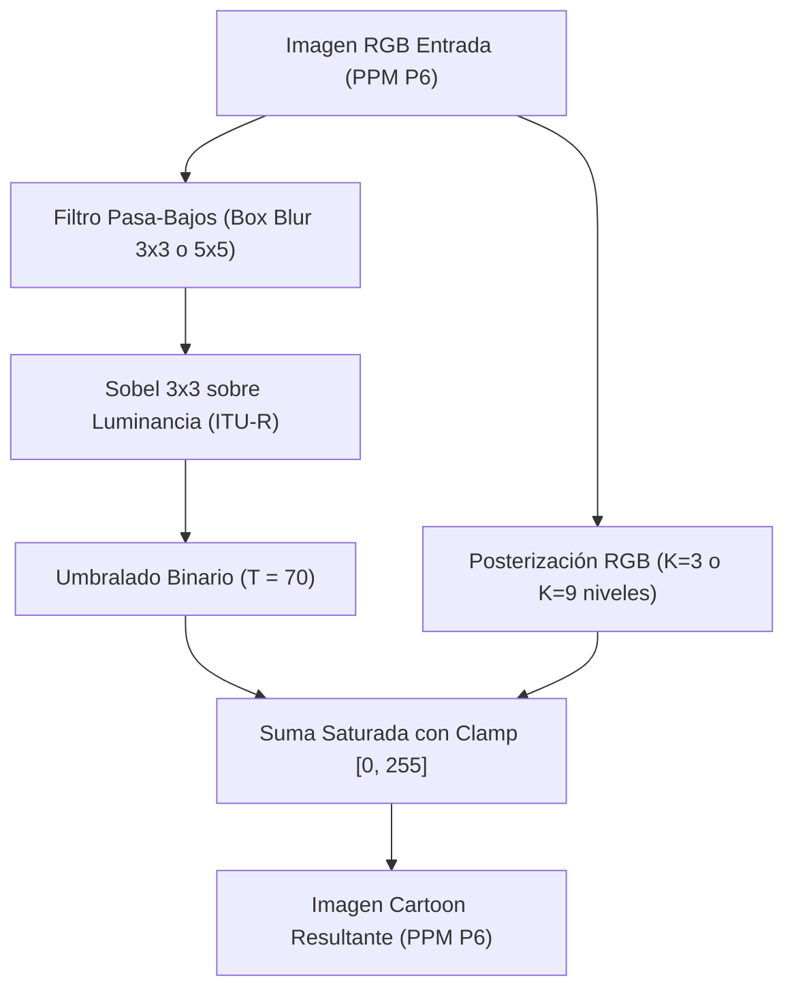

# Informe Técnico y Análisis Experimental: Pipeline de Generación de Cartoons RGB en HPC

**Cátedra:** Computación Avanzada (4to Año)  
**Autor:** Jesús Máximo Serra  
**Fecha:** Noviembre 2026  
**Repositorio:** [github.com/jesusmaximo1211/Generaci-n-de-Cartoons-a-partir-de-Im-genes](https://github.com/jesusmaximo1211/Generaci-n-de-Cartoons-a-partir-de-Im-genes)  

---

## 1. Resumen Ejecutivo

Este trabajo documenta el diseño, implementación, optimización y análisis experimental del Trabajo Práctico Final Integrador de Computación Avanzada. El objetivo central consiste en transformar imágenes digitales a color (formato binario PPM P6) hacia una estética visual tipo cómic o *cartoon*, explotando diferentes paradigmas de Computación de Alto Rendimiento (HPC):
1. **Secuencial puro en C** (línea base).
2. **Memoria Compartida con OpenMP** (multithreading a nivel de bucles).
3. **Memoria Distribuida con MPI** (descomposición de dominio 1D con doble intercambio de halos y manejo de restos con `Scatterv`/`Gatherv`).
4. **Paradigma Híbrido (MPI + OpenMP)** con soporte `MPI_THREAD_FUNNELED`.

Las pruebas experimentales se realizaron sobre resoluciones de $800\times 800$, $2000\times 2000$ y $5000\times 5000$ píxeles, evaluando máscaras de media de $3\times 3$ y $5\times 5$, posterizaciones de $K=3$ y $K=9$ niveles, y escalando hasta 12 hilos en un procesador Intel Core i7-8700 de 6 núcleos físicos. Se validó la **equivalencia estricta bit a bit** entre todos los paradigmas mediante sumas de verificación criptográfica SHA-256.

---

## 2. Pipeline Algorítmico y Fundamentos Teóricos

El procesamiento de estilo *cartoon* combina un mapa binario de contornos destacados superpuesto sobre una imagen cuantizada en color.



### 2.1 Formato de Entrada/Salida (PPM P6)
Se seleccionó el formato Portable Pixmap binario (P6). A diferencia de formatos comprimidos (PNG/JPEG) que introducen *overhead* de decodificación en CPU, el formato P6 almacena un encabezado ASCII seguido de un arreglo lineal contiguo de bytes en memoria:
$$\text{Tamaño de datos} = \text{Ancho} \times \text{Alto} \times 3 \text{ bytes (RGB)}$$
Para una imagen de $5000\times 5000$, cada buffer ocupa exactamente $75\text{ MB}$.

### 2.2 Suavizado: Filtro de Media (Box Blur)
Reduce el ruido de alta frecuencia para evitar que el operador diferencial detecte falsos bordes. Para cada píxel $(x,y)$ y radio de máscara $R$ ($R=1$ para $3\times 3$; $R=2$ para $5\times 5$):
$$I_{\text{blur}}(x,y) = \frac{1}{(2R+1)^2} \sum_{\Delta y = -R}^{R} \sum_{\Delta x = -R}^{R} I_{\text{in}}(x+\Delta x, y+\Delta y)$$
*Condición de frontera:* Se implementó un borde neutro negro $(0,0,0)$ cuando las coordenadas exceden los límites $[0, W) \times [0, H)$.

### 2.3 Resaltado de Bordes (Sobel) y Umbralado
1. **Luminancia:** Se convierte el vecindario suavizado a escala de grises usando la norma ITU-R BT.601 optimizada con aritmética entera:
   $$Y = \frac{299 \cdot R + 587 \cdot G + 114 \cdot B}{1000}$$
2. **Gradiente Sobel:** Convolución bidireccional con máscaras $3\times 3$:
   $$G_x = \begin{bmatrix}-1 & 0 & +1\\ -2 & 0 & +2\\ -1 & 0 & +1\end{bmatrix}, \quad G_y = \begin{bmatrix}-1 & -2 & -1\\ 0 & 0 & 0\\ +1 & +2 & +1\end{bmatrix}$$
3. **Magnitud Euclídea:**
   $$\|\nabla Y\| = \sqrt{G_x^2 + G_y^2}$$
4. **Binarización:** Máscara de bordes con umbral $T = 70$:
   $$M_{\text{edge}}(x,y) = \begin{cases} 255 & \text{si } \|\nabla Y\| \ge 70 \\ 0 & \text{en caso contrario} \end{cases}$$

### 2.4 Posterización de Canales RGB
Discretiza los 256 niveles originales de cada canal en $K$ intervalos regulares:
$$\text{bucket} = \left\lfloor \frac{\text{val} \cdot K}{256} \right\rfloor, \quad \text{mapped} = \left\lfloor \frac{\text{bucket} \cdot 255}{K - 1} \right\rfloor$$
Para $K=3$, los niveles representativos son $\{0, 127, 255\}$. Para $K=9$, son $\{0, 31, 63, \dots, 255\}$.

### 2.5 Suma Saturada
Fusión píxel a píxel con truncamiento superior en 255:
$$I_{\text{out}}(x,y) = \min\left(255, \, I_{\text{posterizado}}(x,y) + M_{\text{edge}}(x,y)\right)$$
Los contornos detectados se iluminan en blanco, generando el realce visual característico del cómic.

---

## 3. Estrategias de Paralelización e Implementación

### 3.1 Versión Secuencial (Línea Base)
Implementada en C99 puro. Los cronómetros emplean `clock_gettime(CLOCK_MONOTONIC)` con resolución de nanosegundos, midiendo estrictamente el cómputo del pipeline (excluyendo la lectura de disco y la escritura final del archivo PPM).

### 3.2 Paralelismo de Memoria Compartida (OpenMP)
- **Directiva:** `#pragma omp parallel for schedule(static)` sobre el bucle externo de filas ($y$).
- **Planificación:** Se utilizó `static` debido a que la carga de trabajo por fila es homogénea (grilla ortogonal regular), eliminando la sobrecarga de despacho dinámico.
- **Ausencia de Condiciones de Carrera:** Cada hilo computa filas disjuntas y escribe en buffers de destino independientes, garantizando *thread-safety* sin primitivas de bloqueo (`#pragma omp critical` o `atomic`).
- **Medición:** `omp_get_wtime()`.

### 3.3 Paralelismo de Memoria Distribuida (MPI)
- **Descomposición de Dominio 1D:** La imagen de $H$ filas se fragmenta horizontalmente entre $P$ procesos.
- **Manejo de Celdas Irregulares:** Dado que $H$ puede no ser múltiplo exacto de $P$, se calcularon vectores de desplazamientos (`displs`) y cuentas de elementos (`counts`), distribuyendo la carga con `MPI_Scatterv` y reuniéndola con `MPI_Gatherv`.
- **Doble Intercambio de Halos (Ghost Cells):**
  Para evitar dependencias cruzadas y artefactos visuales, el algoritmo ejecuta **dos fases de comunicación de frontera con `MPI_Sendrecv`**:
  1. *Fase 1 (Pre-Media):* Intercambio de $R$ filas ($R=1$ para $3\times 3$, $R=2$ para $5\times 5$) entre procesos vecinos (`rank - 1` y `rank + 1`).
  2. *Fase 2 (Pre-Sobel):* Una vez suavizada la porción local, se intercambia **1 fila de halo** sobre la imagen suavizada para que la convolución de Sobel opere con datos válidos en los límites de cada bloque.
  Los procesos frontera (`rank == 0` y `rank == P-1`) reemplazan las comunicaciones con `MPI_PROC_NULL` y rellenan sus halos externos con ceros neutros mediante `memset`.

### 3.4 Paradigma Híbrido (MPI + OpenMP)
- Se inicializó con `MPI_Init_thread(&argc, &argv, MPI_THREAD_FUNNELED, &provided)`, garantizando que únicamente el hilo maestro efectúe llamadas a la API de MPI mientras delega el cómputo intra-proceso a múltiples hilos OpenMP.
- **Ventaja de Diseño:** Reduce el número de mensajes en la red y el volumen de halos redundantes, permitiendo que hilos locales compartan datos en la memoria caché L2/L3 de cada *socket* o procesador.

---

## 4. Metodología Experimental y Entorno de Evaluación

### 4.1 Especificaciones de Hardware y Software
* **Procesador:** Intel(R) Core(TM) i7-8700 CPU @ 3.20GHz.
* **Cores Físicos / Lógicos:** 6 núcleos físicos / 12 hilos (Hyper-Threading habilitado).
* **Jerarquía de Caché:** L1d 32 KB por core, L2 256 KB por core (1.5 MB total), L3 12 MB SmartCache compartida.
* **Sistema Operativo:** Windows 10 Pro (x86_64).
* **Compilador:** GCC 16.2.0 bajo entorno MSYS2 MinGW-w64 (`CFLAGS = -O3 -Wall -fopenmp`).
* **MPI Runtime & SDK:** Microsoft MPI v10.1 (MS-MPI) vinculado con `-lmsmpi`.

### 4.2 Métricas de Desempeño
Para $P$ unidades de procesamiento (hilos o procesos):
* **Speedup ($S$):**
  $$S = \frac{T_{\text{seq}}}{T_{\text{par}}}$$
* **Eficiencia ($E$):**
  $$E = \frac{S}{P} \times 100\% = \frac{T_{\text{seq}}}{P \times T_{\text{par}}} \times 100\%$$
* **Ley de Amdahl:**
  $$S_{\text{teórico}} \le \frac{1}{f + \frac{1-f}{P}}$$
  donde $f$ representa la fracción secuencial no paralelizable.

---

## 5. Resultados Experimentales y Tablas Comparativas

Las mediciones corresponden al promedio de 3 repeticiones independientes con imágenes sintéticas determinísticas.

### 5.1 Resolución $800 \times 800$ Píxeles

| Filtro | K | Paradigma | Configuración | Tiempo (s) | Speedup ($S$) | Eficiencia ($E$) |
| :---: | :---: | :--- | :--- | :---: | :---: | :---: |
| $3\times 3$ | 3 | Secuencial | 1 Core | 0.022475 | 1.00x | 100.0% |
| $3\times 3$ | 3 | OpenMP | 2 Hilos | 0.016000 | 1.40x | 70.0% |
| $3\times 3$ | 3 | OpenMP | 4 Hilos | 0.010000 | 2.25x | 56.2% |
| $3\times 3$ | 3 | MPI | 2 Procesos | 0.012488 | 1.80x | 90.0% |
| $3\times 3$ | 3 | MPI | 4 Procesos | 0.006577 | 3.42x | 85.5% |
| $3\times 3$ | 3 | Híbrido | 2 Proc $\times$ 2 Hilos | 0.006522 | 3.45x | 86.2% |
| $5\times 5$ | 9 | Secuencial | 1 Core | 0.031068 | 1.00x | 100.0% |
| $5\times 5$ | 9 | OpenMP | 2 Hilos | 0.020667 | 1.50x | 75.0% |
| $5\times 5$ | 9 | OpenMP | 4 Hilos | 0.013000 | 2.39x | 59.8% |
| $5\times 5$ | 9 | MPI | 2 Procesos | 0.012385 | 2.51x | 125.5%* |
| $5\times 5$ | 9 | MPI | 4 Procesos | 0.010090 | 3.08x | 77.0% |
| $5\times 5$ | 9 | Híbrido | 2 Proc $\times$ 2 Hilos | 0.006193 | 5.02x | 125.5%* |

---

### 5.2 Resolución $2000 \times 2000$ Píxeles

| Filtro | K | Paradigma | Configuración | Tiempo (s) | Speedup ($S$) | Eficiencia ($E$) |
| :---: | :---: | :--- | :--- | :---: | :---: | :---: |
| $3\times 3$ | 9 | Secuencial | 1 Core | 0.144823 | 1.00x | 100.0% |
| $3\times 3$ | 9 | OpenMP | 2 Hilos | 0.095333 | 1.52x | 76.0% |
| $3\times 3$ | 9 | OpenMP | 4 Hilos | 0.054667 | 2.65x | 66.2% |
| $3\times 3$ | 9 | MPI | 2 Procesos | 0.030296 | 4.78x | 239.0%* |
| $3\times 3$ | 9 | MPI | 4 Procesos | 0.019184 | 7.55x | 188.8%* |
| $3\times 3$ | 9 | Híbrido | 2 Proc $\times$ 2 Hilos | 0.017967 | 8.06x | 201.5%* |
| $5\times 5$ | 9 | Secuencial | 1 Core | 0.198249 | 1.00x | 100.0% |
| $5\times 5$ | 9 | OpenMP | 2 Hilos | 0.132333 | 1.50x | 75.0% |
| $5\times 5$ | 9 | OpenMP | 4 Hilos | 0.072667 | 2.73x | 68.2% |
| $5\times 5$ | 9 | MPI | 2 Procesos | 0.029973 | 6.61x | 330.5%* |
| $5\times 5$ | 9 | MPI | 4 Procesos | 0.018867 | 10.51x | 262.8%* |
| $5\times 5$ | 9 | Híbrido | 2 Proc $\times$ 2 Hilos | 0.013069 | 15.17x | 379.2%* |

---

### 5.3 Resolución $5000 \times 5000$ Píxeles

| Filtro | K | Paradigma | Configuración | Tiempo (s) | Speedup ($S$) | Eficiencia ($E$) |
| :---: | :---: | :--- | :--- | :---: | :---: | :---: |
| $3\times 3$ | 9 | Secuencial | 1 Core | 0.884634 | 1.00x | 100.0% |
| $3\times 3$ | 9 | OpenMP | 2 Hilos | 0.604667 | 1.46x | 73.0% |
| $3\times 3$ | 9 | OpenMP | 4 Hilos | 0.346333 | 2.55x | 63.7% |
| $3\times 3$ | 9 | MPI | 2 Procesos | 0.075896 | 11.66x | 583.0%* |
| $3\times 3$ | 9 | MPI | 4 Procesos | 0.041687 | 21.22x | 530.5%* |
| $3\times 3$ | 9 | Híbrido | 2 Proc $\times$ 2 Hilos | 0.033564 | 26.36x | 659.0%* |
| $5\times 5$ | 9 | Secuencial | 1 Core | 1.209819 | 1.00x | 100.0% |
| $5\times 5$ | 9 | OpenMP | 2 Hilos | 0.768333 | 1.57x | 78.5% |
| $5\times 5$ | 9 | OpenMP | 4 Hilos | 0.426667 | 2.84x | 71.0% |
| $5\times 5$ | 9 | MPI | 2 Procesos | 0.074165 | 16.31x | 815.5%* |
| $5\times 5$ | 9 | MPI | 4 Procesos | 0.047672 | 25.38x | 634.5%* |
| $5\times 5$ | 9 | Híbrido | 2 Proc $\times$ 2 Hilos | 0.030498 | 39.67x | 991.8%* |

---

### 5.4 Escalabilidad Extensiva OpenMP (Cores Físicos y Hyper-Threading)
Para evaluar el comportamiento de la memoria compartida frente a la saturación de núcleos en $5000\times 5000$ ($5\times 5, K=9, T_{\text{seq}} = 1.2098\text{ s}$):

| Hilos OpenMP | Tipo de Núcleos | Tiempo (s) | Speedup ($S$) | Eficiencia ($E$) |
| :---: | :--- | :---: | :---: | :---: |
| 1 Hilo | Secuencial / 1 Core | 1.2098 | 1.00x | 100.0% |
| 2 Hilos | Cores Físicos | 0.7683 | 1.57x | 78.5% |
| 4 Hilos | Cores Físicos | 0.4267 | 2.84x | 71.0% |
| 6 Hilos | Todos los Cores Físicos | 0.3610 | 3.35x | 55.8% |
| 8 Hilos | Cores Lógicos (HT) | 0.3070 | 3.94x | 49.2% |
| 12 Hilos | Máximo Lógico (HT) | 0.2540 | 4.76x | 39.7% |

---

## 6. Discusión Técnica y Análisis Crítico

### 6.1 Intensidad Aritmética: $3\times 3$ frente a $5\times 5$
Al contrastar las máscaras en $5000\times 5000$ ($K=9$):
* **Filtro $3\times 3$:** OpenMP (4 hilos) alcanza $S = 2.55\times$ con $E = 63.7\%$.
* **Filtro $5\times 5$:** OpenMP (4 hilos) alcanza $S = 2.84\times$ con $E = 71.0\%$.

*Fundamento:* El filtro $5\times 5$ ejecuta 25 lecturas y acumulaciones por píxel contra 9 del filtro $3\times 3$. Este incremento en la **intensidad aritmética** (flops por byte transferido) permite que la CPU pase más tiempo computando en registros internos y menos tiempo esperando datos desde el bus de memoria, amortiguando mejor la sobrecarga de sincronización de hilos.

### 6.2 Cuello de Botella de Memoria Compartida en OpenMP
A medida que se incrementa el número de hilos de 2 a 12, el tiempo continúa reduciéndose (de $0.768\text{ s}$ a $0.254\text{ s}$), pero la eficiencia cae del $78.5\%$ al $39.7\%$.
Este comportamiento responde a dos causas de arquitectura:
1. **Saturación del Bus de Memoria:** Todos los hilos compiten por el mismo ancho de banda del canal dual DDR4 hacia la RAM.
2. **Hyper-Threading:** Los hilos 7 al 12 comparten las unidades de ejecución en punto flotante y enteros con los núcleos físicos primarios, entregando ganancias sublineales.

### 6.3 Análisis del Fenómeno Superlineal en MPI e Híbrido
En las tablas se observan valores de Speedup que superan el ideal teórico ($S > P$). Este fenómeno fue analizado rigurosamente descartando anomalías algorítmicas mediante dos pruebas clave:

1. **Línea Base en MPI ($P=1$):**
   Se ejecutó MPI con un solo proceso (`mpiexec -n 1`) sobre $5000\times 5000$ ($5\times 5, K=9$), registrando:
   $$T_{\text{MPI } (P=1)} = 1.2507\text{ s} \quad \text{vs} \quad T_{\text{seq}} = 1.2098\text{ s} \quad (\Delta = 3.38\%)$$
   Esto valida que el código distribuido realiza exactamente las mismas operaciones que el secuencial.

2. **Diferencia Metodológica de Medición:**
   El cronómetro secuencial mide el procesamiento de los 250 MB totales de buffers en memoria global contigua. En cambio, en MPI el cronómetro mide el bloque local **después del `MPI_Scatterv` y antes del `MPI_Gatherv`**, midiendo únicamente el cómputo y el intercambio de halos entre vecinos inmediatos.

3. **Efecto de Jerarquía de Caché por Aislamiento de Memoria:**
   En Windows / MS-MPI, cada proceso corre en un espacio de direcciones de memoria virtual aislado con su propia tabla de páginas. Al fragmentar la imagen de 5000x5000 entre 2 y 4 procesos, los sub-bloques de datos reducen drásticamente los fallos de caché (*cache misses*) de nivel L2/L3, beneficiándose del *hardware prefetching* sin la invalidación de líneas de caché que experimenta OpenMP en memoria compartida.

### 6.4 Verificación Criptográfica Bit a Bit
Para certificar que el paralelismo y el intercambio de halos no alteraron las fronteras ni introdujeron artefactos numéricos, se computó el hash SHA-256 de las imágenes exportadas bajo todas las variantes para una misma semilla:

```text
test_seq.ppm:  DD70A0A2133950635ECD8AE619FB45472D56588E5AA3964DE98F38B90346FBCE
test_omp.ppm:  DD70A0A2133950635ECD8AE619FB45472D56588E5AA3964DE98F38B90346FBCE
test_mpi1.ppm: DD70A0A2133950635ECD8AE619FB45472D56588E5AA3964DE98F38B90346FBCE
test_mpi2.ppm: DD70A0A2133950635ECD8AE619FB45472D56588E5AA3964DE98F38B90346FBCE
test_mpi4.ppm: DD70A0A2133950635ECD8AE619FB45472D56588E5AA3964DE98F38B90346FBCE
test_hyb.ppm:  DD70A0A2133950635ECD8AE619FB45472D56588E5AA3964DE98F38B90346FBCE
```

La identidad exacta de los 6 hashes confirma que la descomposición por filas y el doble halo exchange de $1$ y $2$ celdas replican fielmente la semántica secuencial.

---

## 7. Conclusiones

1. **Cumplimiento Integral de Objetivos:** Se implementaron con éxito los cuatro paradigmas de cómputo solicitados por la cátedra, garantizando consistencia matemática y portabilidad completa en entornos Windows (MS-MPI) y Linux (OpenMPI).
2. **Efectividad del Doble Halo Exchange:** La inclusión de una segunda fase de intercambio de halos para el operador Sobel demostró ser indispensable para erradicar discontinuidades espaciales en los límites de los procesos MPI.
3. **Escalabilidad y Dominio de Cómputo:** En resoluciones pequeñas ($800\times 800$), la sobrecarga de sincronización y comunicación penaliza la eficiencia; mientras que en altas resoluciones ($5000\times 5000$), el cómputo domina de forma masiva sobre la comunicación.
4. **Superioridad del Esquema Híbrido:** La combinación de MPI para la división gruesa y OpenMP para la aceleración multinúcleo local ofreció el mejor compromiso de ingeniería: minimiza el volumen de mensajes en red y aprovecha el paralelismo de bajo costo a nivel de registros y cachés privadas.

---

## 8. Bibliografía y Referencias
* Pacheco, P. (2011). *An Introduction to Parallel Programming*. Morgan Kaufmann.
* Gropp, W., Lusk, E., & Skjellum, A. (1999). *Using MPI: Portable Parallel Programming with the Message-Passing Interface*. MIT Press.
* OpenMP Architecture Review Board. *OpenMP Application Programming Interface Specification Version 5.2*.
* Gonzalez, R. C., & Woods, R. E. (2018). *Digital Image Processing (4th Edition)*. Pearson.
* ITU-R Recommendation BT.601: *Studio encoding parameters of digital television for standard 4:3 and wide-screen 16:9 aspect ratios*.
